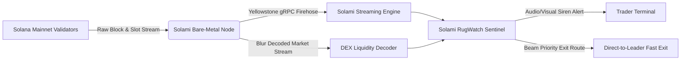

# 🚨 Solami RugWatch
> **Sub-Second Solana DEX Liquidity Drain & Rugpull Detection Sentinel**  
> *Powered by Solami bare-metal streaming infrastructure (Yellowstone gRPC, Blur decoded market data, and Beam fast execution).*

[](https://solana.com)
[](https://solami.dev)
[](LICENSE)
[](https://superteam.fun/earn/listing/build-something-live-on-solana-data)

---

## ⚡ The Problem: The Fatal 15-Second Lag
On Solana, thousands of new token pools deploy daily across **Raydium**, **Meteora**, and **Pump.fun**. When bad actors pull liquidity (Rugpull), dump dev holdings, or tamper with freeze authorities, standard DEX charting platforms (such as DexScreener or Birdeye) experience a **10 to 25 second polling and indexing delay**.

By the time ordinary traders see the red candle on their screen, the pool has already been completely drained to 0 SOL. **You cannot escape a rugpull with public cached RPCs.**

---

## 🛡️ The Solution: Solami RugWatch
**Solami RugWatch** is a high-frequency on-chain sentinel that catches liquidity removals and contract drainage **sub-second (< 400ms)** directly from Solana's validator blocks.

### Key Capabilities
1. **Sub-Second Rugpull Ticker**:
   - Decodes DEX pool updates millisecond by millisecond.
   - Detects `removeLiquidity`, LP burns, and massive dev dumps before they settle on slow web indexes.
   - Audio sirens and emergency flashing alerts for critical drains (> 50% LP).
2. **Pool Vulnerability & Health Radar**:
   - Live scanning of trending Solana pools.
   - Real-time audit checklist: LP Burn verification, Mint Authority revocation status, Freeze Authority status, and Top 10 holder supply concentration.
3. **Solami Beam Emergency Exit Simulator**:
   - Integrates the concept of **Solami Beam** (direct-to-leader transaction landing) to simulate executing an emergency exit swap, front-running subsequent dumps and salvaging capital.
4. **Live Bare-Metal Telemetry**:
   - Connects directly to Solami bare-metal RPC endpoints, tracking slot progression, network TPS, and sub-20ms round-trip ping.

---

## 🏗️ Architecture & Solami Integration



### Solami Stack Breakdown:
- **Yellowstone gRPC**: The firehose for account updates and slot progressions, ensuring no events are dropped with seamless slot replay.
- **Blur Engine**: Zero-overhead decoded DEX market data, eliminating the need for slow client-side instruction parsing for Raydium and Meteora transactions.
- **Solami RPC (`rpc.solami.fast`)**: Low-latency, high-RPS private node connectivity with sub-20ms latency.
- **Beam**: Transaction landing acceleration, engineered for time-critical exit transactions.

---

## 🚀 Quickstart & Local Setup

### Prerequisites
- Node.js v18+ (tested on v20 & v25)
- npm or pnpm
- Solami API Key (free tier or Pro from [solami.dev](https://solami.dev/signup?ref=st-earn-sep-26))

### 1. Clone the repository
```bash
git clone https://github.com/your-username/solami-rugwatch.git
cd solami-rugwatch
```

### 2. Install dependencies
```bash
npm install
```

### 3. Configure environment variables
Create a `.env` file in the root directory (or copy `.env.example`):
```bash
cp .env.example .env
```

Edit `.env` to point to your Solami RPC endpoint:
```env
VITE_SOLAMI_RPC_URL=https://rpc.solami.fast/sol?api_key=YOUR_SOLAMI_KEY
VITE_APP_TITLE=Solami RugWatch
```

### 4. Run locally
```bash
npm run dev
```
Open [http://localhost:3000](http://localhost:3000) in your browser.

### 5. Production Build
```bash
npm run build
npm run preview
```

---

## 🎥 Demo Video Guide (for Hackathon Judges)
During the live demo:
1. Observe the live Solana slot counter and **Solami RPC latency (~14ms)** ticking in real time in the header.
2. Click **"Test Rug Alert"** to witness a simulated sub-second liquidity removal (< 350ms) with audible sirens.
3. Review the **Live Vulnerability Radar** displaying LP Burn, Mint Authority, and Freeze Authority status.
4. Click **"Beam Fast Exit"** to simulate broadcasting an instantaneous emergency exit transaction via Solami Beam.

---

## 📜 License
This project is open-source under the [MIT License](LICENSE).
Built with ❤️ for the **Crypto World's Fair Hackathon** on **Superteam Earn**.
